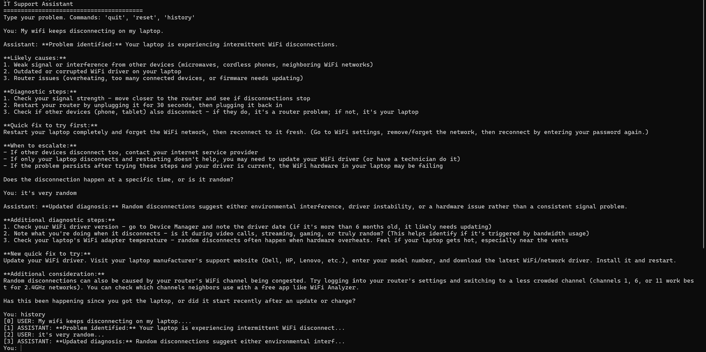

# IT Helper CLI

An AI-powered command-line IT troubleshooting assistant built with Python and the Anthropic API. Describe a technical problem in plain English and get structured, step-by-step troubleshooting guidance, with conversation context carried across follow-up questions.

<p align="center">
  
</p>

> **Status:** Day 3 complete — conversation memory and interactive CLI.

---

## Overview

IT Helper is a learning project exploring how to build an AI application from the ground up. A system prompt guides Claude's responses, and the app stores conversation history so follow-up questions can build on what was shared earlier.

## Features

- **Interactive CLI** — ask IT troubleshooting questions directly in the terminal.
- **AI-powered responses** — uses Claude Haiku via the Anthropic API.
- **Structured troubleshooting** — every answer covers:
  - Problem identification
  - Likely causes
  - Diagnostic steps
  - A quick fix to try first
  - When to escalate
- **Conversation memory** — keeps context by storing and resending previous messages.
- **Conversation controls** — `history`, `reset`, and `quit` commands.

## Architecture

```
User
  │
  ▼
main.py ─────────── CLI and interactive loop
  │
  ▼
conversation.py ─── Manages conversation history
  │
  ├──► config.py ── System prompt
  │
  ▼
Anthropic Python SDK
  │
  ▼
Anthropic API ──► Claude Haiku
  │
  ▼
Structured troubleshooting response → back to the user
```

**How it works**

1. The user enters a technical question in the terminal.
2. `main.py` handles the input and passes it to the conversation manager.
3. `conversation.py` appends the message and sends the full history to Claude, along with the system prompt from `config.py`.
4. The response is added to the history and printed to the terminal.

> **Key concept:** The Claude API is stateless — it doesn't remember previous requests. The application creates continuity by managing and resending the message history on every call.

## Project Structure

```
it-helper/
├── main.py              # CLI entry point and interactive loop
├── conversation.py      # Conversation management and history
├── config.py            # IT support system prompt
├── .env.example         # Template for the API key
├── .gitignore           # Files Git should ignore
├── requirements.txt     # Python dependencies
├── asset                # Screenshots for the README
├── LICENSE              # LICENSE
└── README.md            # Project documentation
```

| File | Purpose |
|------|---------|
| `main.py` | Runs the app, accepts input, handles commands, prints responses. |
| `conversation.py` | Manages conversation state, sends history to Claude, provides history/reset methods. |
| `config.py` | Defines the system prompt that tells Claude how to respond to IT problems. |
| `.env` | Stores your local Anthropic API key (not committed). |
| `.env.example` | Shows the required environment variable without a real secret. |
| `.gitignore` | Keeps `.env` and `venv/` out of Git. |
| `requirements.txt` | Lists the required Python packages. |

## Example Conversation

```
IT Support Assistant
========================================
Type your problem. Commands: 'quit', 'reset', 'history'

You: My wifi keeps disconnecting on my laptop.

Assistant: **Problem identified:** Your laptop is experiencing intermittent WiFi disconnections.

**Likely causes:**
1. Weak signal or interference from other devices (microwaves, cordless phones, neighboring WiFi networks)
2. Outdated or corrupted WiFi driver on your laptop
3. Router issues (overheating, too many connected devices, or firmware needs updating)

**Diagnostic steps:**
1. Check your signal strength - move closer to the router and see if disconnections stop
2. Restart your router by unplugging it for 30 seconds, then plugging it back in
3. Check if other devices (phone, tablet) also disconnect - if they do, it's a router problem; if not, it's your laptop

**Quick fix to try first:**
Restart your laptop completely and forget the WiFi network, then reconnect to it fresh. (Go to WiFi settings, remove/forget the network, then reconnect by entering your password again.)

**When to escalate:**
- If other devices disconnect too, contact your internet service provider
- If only your laptop disconnects and restarting doesn't help, you may need to update your WiFi driver (or have a technician do it)
- If the problem persists after trying these steps and your driver is current, the WiFi hardware in your laptop may be failing

Does the disconnection happen at a specific time, or is it random?

You: it's very random

Assistant: **Updated diagnosis:** Random disconnections suggest either environmental interference, driver instability, or a hardware issue rather than a consistent signal problem.

**Additional diagnostic steps:**
1. Check your WiFi driver version - go to Device Manager and note the driver date (if it's more than 6 months old, it likely needs updating)
2. Note what you're doing when it disconnects - is it during video calls, streaming, gaming, or truly random? (This helps identify if it's triggered by bandwidth usage)
3. Check your laptop's WiFi adapter temperature - random disconnects often happen when hardware overheats. Feel if your laptop gets hot, especially near the vents

**New quick fix to try:**
Update your WiFi driver. Visit your laptop manufacturer's support website (Dell, HP, Lenovo, etc.), enter your model number, and download the latest WiFi/network driver. Install it and restart.
```

## Technologies

- **Python** — application logic and CLI
- **Anthropic Python SDK** — API communication
- **Claude Haiku** — language model
- **python-dotenv** — loads environment variables from `.env`
- **Git & GitHub** — version control and hosting
- **WSL2 / Ubuntu** — development environment

## Setup and Installation

### Prerequisites

- Python 3.10 or newer
- Git
- An [Anthropic API key](https://console.anthropic.com/)

### 1. Clone the repository

```bash
git clone https://github.com/glenbuildsai/it-helper.git
cd it-helper
```

### 2. Create and activate a virtual environment

On WSL2 or Linux:

```bash
python3 -m venv venv
source venv/bin/activate
```

### 3. Install dependencies

```bash
python -m pip install -r requirements.txt
```

### 4. Configure your API key

```bash
cp .env.example .env
```

Open `.env` and replace the placeholder with your key:

```
ANTHROPIC_API_KEY=your_actual_api_key_here
```

### 5. Run the application

```bash
python main.py
```

Enter a technical problem when prompted.

| Command | Action |
|---------|--------|
| `history` | Show the stored conversation history |
| `reset` | Clear the current conversation |
| `quit` | Exit the application |

## Security

- Never commit `.env` or expose your API key.
- Keep `.env` listed in `.gitignore`.
- Use `.env.example` as a template with placeholder values only.
- Don't share API keys in screenshots, logs, or public repositories.

> `.env` keeps the key out of your source code, but it is **not** an encrypted vault. Keep it private and rotate the key if it's ever exposed.

## What I Learned

This was my first AI project, and it introduced me to the foundations of AI application development:

- **API authentication** — connecting Python to an external AI service
- **Environment management** — virtual environments and dependencies
- **Secrets management** — loading API keys from environment variables
- **System prompts** — guiding model behaviour through instructions
- **Structured responses** — encouraging consistent output
- **Stateless LLM APIs** — understanding that requests aren't remembered automatically
- **Application-managed memory** — storing and resending conversation history
- **Interactive CLI design** — building a REPL-style app
- **Separation of concerns** — keeping app logic, conversation management, and prompts in separate files

## Roadmap

- [x] **Day 1** — Environment setup, API authentication, first API call
- [x] **Day 2** — System prompts and structured responses
- [x] **Day 3** — Conversation memory and interactive CLI
- [ ] **Day 4** — Better error handling and CLI polish
- [ ] **RAG** — Retrieve relevant info from an IT knowledge base before answering
- [ ] **Evaluations** — Test responses against a defined set of IT questions and quality criteria
- [ ] **Agentic tools** — Controlled tools such as reading log files or checking a URL

## Project Goal

Build practical AI engineering skills by developing, testing, and improving working software — not just learning AI concepts in theory.

## License

This project is licensed under the MIT License — see [LICENSE](LICENSE) for details.
